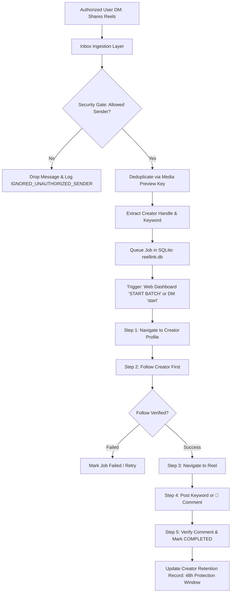

# ReelLink ⚡
### Autonomous Instagram Reel Ingestion, Follow-First & Comment Automation Engine

> **Eliminating the friction between "Comment KEYWORD for the link" and actual Instagram engagement.**

ReelLink is a robust, security-hardened local automation system that interfaces with Instagram Web via Playwright. When an authorized user shares Instagram Reels to the bot's direct chat, ReelLink ingests the shared Reels, extracts creator handles and caption keywords, follows the creator first, verifies the follow outcome, and comments the keyword on the Reel to trigger the creator's automated delivery.

---

## 📑 Table of Contents

1. [System Architecture & Flow](#-system-architecture--flow)
2. [The 5-Step Non-Negotiable Workflow](#-the-5-step-non-negotiable-workflow)
3. [Strict Security Model & Allowlist](#-strict-security-model--allowlist)
4. [Smart 2-Day Creator Retention & Unfollow Manager](#-smart-2-day-creator-retention--unfollow-manager)
5. [Dual Execution Triggers (Dashboard & In-Chat)](#-dual-execution-triggers)
6. [Instagram DM Bot Commands](#-instagram-dm-bot-commands)
7. [Web Dashboard & Monitoring](#-web-dashboard--monitoring)
8. [Setup & Running Instructions](#-setup--running-instructions)
9. [Automated Test Suite](#-automated-test-suite)

---

## 🏛️ System Architecture & Flow



---

## ⚡ The 5-Step Non-Negotiable Workflow

ReelLink follows a strict, sequential pipeline engineered for safety, compliance, and zero wasted actions:

1. **Ingest & Deduplicate:**
   - Detects shared Reel cards in the authorized chat thread.
   - Filters out creator avatar thumbnails (`profile_pic`, `s50x50`) to isolate the true Reel media preview key (`ig_cache_key`).
   - Ensures the exact same message is never processed twice, while allowing legitimate new shares of the same Reel.
2. **Metadata & Keyword Extraction:**
   - Extracts creator username (`@creator`).
   - Parses Reel caption to extract call-to-action keywords (e.g. `ROADMAP`, `INFOSYS`, `PLAYWRIGHT`).
   - **Fallback Safeguard:** If no explicit keyword is found in the caption, defaults gracefully to the `🙌` emoji.
3. **Operator Approval:**
   - Evaluates execution mode (`--auto-approve` for autonomous batch execution or supervised manual approval).
4. **Follow Creator First:**
   - Navigates to the creator's profile page (`https://instagram.com/<creator>/`).
   - Verifies existing follow state. If not following, clicks **Follow** and confirms the button transitions to **Following** or **Requested**.
   - **Never comments before follow verification succeeds.**
5. **Post Keyword Comment:**
   - Navigates to the Reel URL (`https://instagram.com/reel/<shortcode>/` or `/p/<shortcode>/`).
   - Types the extracted keyword into the comment field, clicks **Post**, and verifies the comment appears in the feed.
   - Marks the job as `COMPLETED` immediately. Does not search external search engines, wait for DMs, or forward raw chat messages.

---

## 🔒 Strict Security Model & Allowlist

Because the bot account operates on a public Instagram profile, anyone on Instagram could potentially send direct messages or share Reels. ReelLink enforces a **fail-closed, multi-tier security gate**:

### Authorized Requester Allowlist
Configured in `src/security/sender-allowlist.js`:
- `@nauman`
- `@naumannn`
- `@ksydn_`

### 6-Layer Fail-Closed Checkpoints
1. **Inbox Sidebar Scan (`pollForIncomingReels`):** Only polls threads matching authorized usernames. All unauthorized sender rows are ignored immediately (`[WARN] IGNORED_UNAUTHORIZED_SENDER`).
2. **Batch Collector (`collectUnprocessedReels`):** Restricts Reel harvesting strictly to the designated authorized thread ID.
3. **Thread Inspector (`checkThreadForReels`):** Validates thread header before inspecting clip cards.
4. **Command Dispatcher (`handleBotCommand`):** Rejects all bot commands (`/status`, `/reset`, `/unfollow`, `/start`) from unauthorized users silently without executing browser actions or sending replies.
5. **Queue Ingestion (`createJob`):** Rejects insertion into SQLite if `enforceAllowlist` fails.
6. **Worker Dispatcher (`processJob`):** Final runtime check ensures no job executes without an authorized sender tag.

**Result:** Zero state pollution, zero unauthorized Playwright actions, and complete isolation from external Instagram users.

---

## 🛡️ Smart 2-Day Creator Retention & Unfollow Manager

### Why 2-Day Protection Matters
Immediately unfollowing accounts after commenting triggers Instagram anti-spam heuristic flags, ruins algorithmic trust scores, and may prevent creator bots from delivering automated resources.

ReelLink implements a smart **48-Hour Retention Engine** in `src/queue/jobs.js`:
- Every followed creator is logged with a verified timestamp (`live_follow_verified_at`).
- **Protected Accounts (`< 48 hours`):** Creators followed within the last 2 days are shielded from premature unfollow churn.
- **Eligible Accounts (`≥ 48 hours`):** Creators followed 2 or more days ago become eligible for automated pruning.

### Unfollow Control Modes
- **Smart Pruning (Default):** Unfollows only creators who have passed the 48-hour retention window.
- **Force All Override:** Explicit confirmation command to unfollow all tracked accounts if an immediate clean slate is desired.

---

## 🚀 Dual Execution Triggers

Rather than continuously polling or freezing on single Reels, ReelLink supports on-demand batching:

1. **Web Dashboard Trigger:**
   - Open `http://localhost:3000` in any browser.
   - Click the **▶ START BATCH** button.
   - ReelLink will scan all unread shared Reels in the authorized chat, queue them, and process each sequentially with a live progress bar.
2. **Instagram In-Chat Trigger:**
   - Share as many Reels as you want to the bot chat throughout the day.
   - When ready, simply send `"start"` or `"/start"` in the Instagram DM conversation from `@nauman` or `@ksydn_`.
   - The bot replies acknowledging the batch start and begins execution immediately.

---

## 💬 Instagram DM Bot Commands

Authorized requesters can control the bot directly inside Instagram Direct Messages:

| Command | Aliases | Description | Confirmation Required |
| :--- | :--- | :--- | :--- |
| `/help` | `/menu`, `!help`, `!menu` | Displays the complete interactive command reference. | No |
| `/status` | `!status` | Real-time status: mode, queue metrics, awaiting approval, failed jobs, uptime. | No |
| `/history` | `!history` | Shows the last 10 processed Reels, creator usernames, and follow/comment outcomes. | No |
| `start` | `/start`, `!start` | Triggers batch scan and execution of all pending/unread Reels in chat. | No |
| `/reset` | `!reset` | Previews jobs eligible for cancellation (`PENDING`, `AWAITING_APPROVAL`). | No (Preview) |
| `/reset confirm` | `!reset confirm` | Cancels eligible unstarted jobs without altering completed history. | **Yes** |
| `/unfollow` | `!unfollow` | Previews creators segmented by **Eligible (>2 days)** vs **Protected (<2 days)**. | No (Preview) |
| `/unfollow confirm` | `!unfollow confirm` | Safely unfollows only eligible creators (>2 days old); preserves protected. | **Yes** |
| `/unfollow all confirm` | `!unfollow all confirm` | Explicit override: unfollows all creators immediately regardless of age. | **Yes** |

---

## 🌐 Web Dashboard & Monitoring

ReelLink includes a built-in dark-mode dashboard accessible at `http://localhost:3000`:

- **One-Click Batch Execution:** Large Start/Stop button with animated progress bar and live status pill (`SCANNING_INBOX`, `PROCESSING [X/Y]`, `READY`).
- **Real-Time Metrics Grid:** Live counters for Pending Queue, Total Completed, Followed Today, and Bot Uptime.
- **2-Day Creator Retention Manager:**
  - Displays counts for **Eligible for Pruning (≥ 2 Days)** and **Protected in Retention (< 2 Days)**.
  - Interactive **[ 🛡️ Unfollow Eligible ]** and **[ ⚠️ Force All ]** action buttons.
  - Creator breakdown table with age in days, status tags, and countdown timers.
- **Recent Processed Reels Table:** Live shortcode links, creator handles, extracted keywords, follow tags, and comment status.
- **Live Activity Console:** Real-time log stream showing browser operations and execution milestones.

---

## 🛠️ Setup & Running Instructions

### 1. Prerequisites
- **Node.js**: v18.0.0+ (Tested on Node v24)
- **Windows OS** (PowerShell)
- **Chromium / Playwright**

### 2. Install Dependencies
```powershell
npm.cmd install
```

### 3. Initialize Instagram Session
Log in once interactively to store session state in `data/browser_profile/`:
```powershell
npm.cmd run setup:session
```
*A Chromium window opens $\to$ Log into Instagram $\to$ Verify your Direct Inbox is visible $\to$ Close the browser.*

### 4. Start the Application Daemon & Web Dashboard
```powershell
npm.cmd run dashboard
```
*Starts the ReelLink daemon in live mode with auto-approve enabled, connects to Instagram Direct, and launches the web dashboard at `http://localhost:3000`.*

---

## 🧪 Automated Test Suite

ReelLink includes a comprehensive automated test suite covering all units, security gates, command dispatchers, web endpoints, and the 2-day unfollow retention engine.

Run all tests:
```powershell
npm.cmd test
```

### Test Coverage Highlights
- `test-sender-allowlist.js`: Strict validation of authorized senders and fail-closed gates.
- `test-bot-commands.js`: Complete coverage for `/help`, `/status`, `/history`, `/reset`, `/unfollow`.
- `test-two-day-unfollow.js`: Unit & integration tests for the 48-hour creator retention segregation, API endpoints, and command confirmation safety.
- `test-batch-trigger-and-web.js`: Web dashboard HTML delivery, `/api/status`, `/api/start`, `/api/unfollow`, and concurrent batch locking.
- `test-comment-only-workflow.js`: Verifies the 5-step follow-first-then-comment execution flow.

**Status:** `126 tests passing, 0 failing, 0 regressions.`
