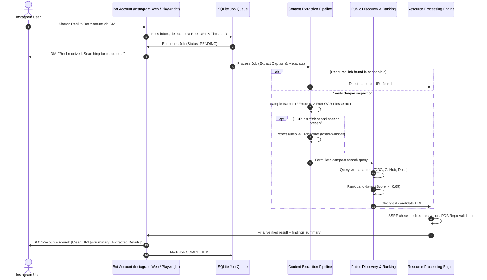

# ReelLink: Autonomous Instagram Reel Resource Discovery Bot
## Project Master Textbook & Technical Specification

> **Status:** Canonical Living Specification (Milestone 0)  
> **Author & Documentation Owner:** Lead Software Engineer & Implementation Agent  
> **Project Orchestrator:** ChatGPT  
> **Target Environment:** Windows 10/11 Local Host, Node.js + Python Runtime  
> **Last Updated:** 2026-10-19

---

## 1. Executive Summary

**ReelLink** is an autonomous personal research prototype designed to eliminate the multi-step friction involved in acquiring resources promised by Instagram Reel creators (e.g., "Comment GUIDE for the PDF", "DM for source code", "Full tutorial at link").

Rather than manually commenting, following creator accounts, monitoring direct messages for automated marketing bots (such as ManyChat), opening tracking links, and sifting through lead magnets, the user simply **shares an Instagram Reel to a dedicated bot account via Instagram Direct Messages (DM)**. 

ReelLink operates locally on the user's continuously connected Windows PC. It monitors the bot's Instagram inbox, parses incoming shared Reels, extracts high-signal clues through a tiered and cost-conscious pipeline (metadata -> frame-wise OCR -> optional audio transcription), conducts targeted public web and repository discovery, and returns the verified target resource (e.g., GitHub repository, direct PDF, canonical documentation, or clean destination URL) directly back to the user in their Instagram conversation. If public discovery fails, the bot can conditionally evaluate the creator's explicit automated workflow with user guardrails, or return a transparent summary of candidates and failures.

---

## 2. Problem Statement

Short-form video platforms—chiefly Instagram Reels—have become primary distribution funnels for developers, educators, marketers, and technical content creators. To optimize algorithmic engagement (comments, shares, saves, and follows), creators deliberately withhold direct resource URLs from video descriptions and on-screen overlays, deploying "engagement-bait" automation patterns:

1. **Gated Comment CTAs:** "Comment `REPO` and my bot will DM you the link."
2. **Follow-to-Receive Gates:** "Follow me and DM `PROMPT` to get the cheat sheet."
3. **Obfuscated / Ephemeral Links:** Showing a URL on screen for 0.5 seconds or directing viewers to multi-tiered link-in-bio aggregators (Linktree, Beacons, Stan Store) filled with newsletters and upsells.
4. **Marketing Automation Delays:** ManyChat / Chatfuel bots that require users to provide an email address, verify via OTP, or wait for scheduled DM queues.

This creates substantial cognitive and operational friction:
- Context switching out of the content stream.
- Inundation of the user's personal direct inbox with promotional drip campaigns.
- Manual data entry on landing pages designed for lead capture rather than clean knowledge retrieval.
- Wasted time when the promised resource turns out to be a generic sales pitch or low-value affiliate link.

---

## 3. Existing User Workflow vs. ReelLink Workflow

### Traditional Manual Workflow
```
[User watches Reel]
       │
       ▼
[Reads CTA: "Comment GUIDE"]
       │
       ▼
[Posts public comment on Reel] ──> [Algorithm boosts creator's reach]
       │
       ▼
[Waits 1 - 30 minutes for automated DM]
       │
       ▼
[Receives DM from creator's marketing bot]
       │
       ▼
[Bot demands: "Follow me first" or "Enter your email"]
       │
       ▼
[Clicks marketing aggregator link / enters email]
       │
       ▼
[Opens email confirmation / navigates spam traps]
       │
       ▼
[Finally reaches actual PDF or GitHub repo]
```
*Total elapsed time:* 5 to 45 minutes. *Friction score:* High. *Privacy exposure:* High (public comments, email lists).

### ReelLink Autonomous Workflow
```
[User watches Reel]
       │
       ▼
[Shares Reel to dedicated ReelLink bot via DM]
       │
       ▼
[ReelLink receives Reel URL locally] ──> [Sends quick ACK: "Reel received. Looking for resource..."]
       │
       ├─► [Stage A: Extract Caption, OCR on sampled frames, Audio Transcript]
       ├─► [Stage B: Fast Public Search (GitHub, direct PDFs, creator bio/links)]
       └─► [Stage C: (Fallback) Creator DM/Comment automation if needed]
       │
       ▼
[Resource verified & sanitized (SSRF-safe, redirect resolved)]
       │
       ▼
[Bot replies in DM: Verified Clean Link + Extracted Summary / Key Findings]
```
*Total elapsed time:* 15 to 45 seconds. *Friction score:* Zero. *Privacy exposure:* Minimal.

---

## 4. Product Vision

ReelLink transforms Instagram from a high-friction engagement trap into an autonomous knowledge-capture tool. The user treats their Instagram DM thread with the bot as a personal "fetch assistant": share any Reel containing a resource, code, guide, tool, or document, and receive the actual artifact without ever commenting, following, or joining an email list.

Core Tenets:
- **Zero Hallucination:** Never invent URLs or claim success without evidence.
- **Cost & Compute Conservation:** Cheapest operations run first; heavy operations (video download, OCR, Whisper) execute only when simpler metadata yields no definitive answer.
- **Radical Transparency:** If a resource cannot be found or requires paywalls, state the exact reason and list the highest-confidence public candidates.
- **Account Safety & Privacy:** No credential leakage, no uncontrolled spamming, and persistent browser session isolation.

---

## 5. Target User and Primary Use Case

### Target User
The user is a technical professional / power user operating on a dedicated Windows workstation that remains powered on and connected to broadband internet.

### Primary Use Cases
1. **Developer Open-Source Retrieval:** A Reel demonstrates a cool open-source AI project ("Comment CODE for the GitHub"). ReelLink retrieves the exact GitHub repository link and its README summary.
2. **Cheat Sheets & Engineering Guides:** A Reel advertises an infographic or PDF guide ("Comment DOCKER for cheat sheet"). ReelLink locates the direct PDF, extracts its core contents, and returns the verified download link.
3. **Tutorial / Architecture Deep Dives:** A Reel references an external blog post, Notion workspace, or YouTube deep dive. ReelLink extracts the canonical resource link and returns it.

---

## 6. Functional Requirements

- **FR-1 (Inbox Monitoring):** Continuously monitor incoming Direct Messages on the dedicated Instagram bot account.
- **FR-2 (Reel URL Ingestion):** Detect shared Reels, direct Instagram links, and shortcodes (`/reel/CRxxxx/`, `/p/CRxxxx/`).
- **FR-3 (Deduplication & State Management):** Persist message IDs and Reel shortcodes in SQLite to guarantee idempotent processing.
- **FR-4 (Tiered Metadata Extraction):** Extract creator handle, caption, hashtags, and embedded links without full video download when possible.
- **FR-5 (Frame-wise Adaptive OCR):** Download video only if needed; sample frames via FFmpeg (default 1 frame every 2 seconds); filter duplicate frames; execute local Tesseract OCR.
- **FR-6 (Local Audio Transcription):** Extract audio track via FFmpeg and execute local `faster-whisper` transcription on CPU/GPU fallback only when metadata and OCR are insufficient.
- **FR-7 (Distinctive Query Formulation):** Synthesize extracted caption, OCR tokens, and transcript terms into clean, targeted search queries.
- **FR-8 (Modular Web Discovery):** Query public web search providers (DuckDuckGo, SerpAPI, Tavily, Google Custom Search) and creator public profiles.
- **FR-9 (Candidate Ranking & Thresholding):** Rank candidate URLs against Reel tokens with a strict confidence score ($0.0 \dots 1.0$); halt early on high confidence.
- **FR-10 (URL Validation & SSRF Guard):** Resolve redirects, verify MIME types, block internal/private IP ranges (RFC 1918), and normalize tracking parameters.
- **FR-11 (PDF & Document Extraction):** Validate PDF signatures, check file sizes ($< 25\text{ MB}$), extract text/links via PyMuPDF locally, and summarize key sections.
- **FR-12 (Creator Workflow Fallback):** If public search fails and a comment/DM keyword trigger is identified, optionally trigger the interaction under explicit user approval guardrails.
- **FR-13 (Instagram DM Delivery):** Deliver structured, readable responses back to the original DM thread with links, status, and concise findings.
- **FR-14 (Process Resilience & Crash Recovery):** On process restart, recover pending/stalled jobs from SQLite without losing state or double-messaging.

---

## 7. Non-Functional Requirements

- **NFR-1 (Cost Efficiency):** Default operation must incur zero external API costs by utilizing local OCR (Tesseract), local transcription (faster-whisper), local browser automation (Playwright), and free/public search adapters.
- **NFR-2 (Latency Budget):**
  - Metadata-only resolution: $< 15\text{ seconds}$
  - OCR-assisted resolution: $< 35\text{ seconds}$
  - Full transcription resolution: $< 75\text{ seconds}$
- **NFR-3 (Resource Footprint):** CPU utilization must average $< 5\%$ during idle monitoring. Peak RAM usage must stay below $2.5\text{ GB}$ during Whisper/FFmpeg runs.
- **NFR-4 (Operational Reliability):** 24/7 continuous operation on Windows 10/11. Graceful recovery from network disconnects, Instagram session expirations, and unhandled worker errors.
- **NFR-5 (Security & Credential Isolation):** No plain-text passwords or cookies written to logs. Browser profile directories and databases excluded from repository tracking.
- **NFR-6 (Modularity):** Decoupled subsystems with clear interfaces (Instagram transport, Job queue, Content extractor, Search provider, Resource validator).

---

## 8. Explicit Scope and Exclusions

### In Scope
- Single-machine local deployment on Windows PC.
- Dedicated secondary Instagram bot account for receiving shares and sending DMs.
- Instagram Web DM automation via Playwright with persistent browser context.
- Local video processing (FFmpeg, Tesseract, faster-whisper).
- SQLite-backed transactional job queue.
- Public web candidate search and validation.
- Sanitized markdown/text delivery in Instagram DMs.

### Out of Scope (Exclusions for MVP)
- Multi-tenant cloud hosting, Kubernetes clusters, or distributed queues (Celery, Redis).
- Reverse engineering Instagram private mobile APIs or using unstable, ban-prone private API wrappers.
- Defeating Cloudflare challenges, Captchas, or account SMS verification bypasses.
- Executing downloaded binaries, scripts, or installer files.
- Full video computer vision / scene classification via expensive multimodal cloud APIs (GPT-4V / Gemini Cloud) by default.
- Building a standalone web dashboard UI (Instagram DM is the primary interface).

---

## 9. End-to-End Workflow



---

## 10. System Architecture

ReelLink is structured as a decoupled, event-driven monolith optimized for Windows local execution:

```
┌──────────────────────────────────────────────────────────────────────────────┐
│                              REELLINK CORE                                   │
├──────────────────────────────────────────────────────────────────────────────┤
│                                                                              │
│  ┌─────────────────────────┐          ┌──────────────────────────────────┐  │
│  │   Instagram Transport   │          │        SQLite Job Manager        │  │
│  │  (Playwright Browser)   │◄────────►│     (State, Retries, Dedup)      │  │
│  │  Inbox Poller & Sender  │          │      data/reellink.db            │  │
│  └───────────┬─────────────┘          └────────────────┬─────────────────┘  │
│              │ (Incoming Reel)                         │                     │
│              ▼                                         ▼                     │
│  ┌────────────────────────────────────────────────────────────────────────┐  │
│  │                     Staged Content Extractor                           │  │
│  │  1. Metadata / Caption Parser                                          │  │
│  │  2. Video Downloader & FFmpeg Frame Sampler                            │  │
│  │  3. Local Tesseract OCR Engine                                         │  │
│  │  4. Local faster-whisper Python Transcription Worker                   │  │
│  └───────────────────────────────────┬────────────────────────────────────┘  │
│                                      │ (Tokens, Evidence, Clues)             │
│                                      ▼                                       │
│  ┌────────────────────────────────────────────────────────────────────────┐  │
│  │                    Modular Search & Discovery                          │  │
│  │  - Search Query Builder                                                │  │
│  │  - Provider Adapters (DuckDuckGo, SerpAPI, Tavily, Google PSE)         │  │
│  │  - Candidate Evaluation & Scorer (Weighted Token Match)                │  │
│  └───────────────────────────────────┬────────────────────────────────────┘  │
│                                      │ (Candidate URL)                       │
│                                      ▼                                       │
│  ┌────────────────────────────────────────────────────────────────────────┐  │
│  │                    Resource Processing Engine                          │  │
│  │  - URL Sanitizer & SSRF Filter                                         │  │
│  │  - Redirect Resolver (Unshortener)                                     │  │
│  │  - PDF Inspector & PyMuPDF Local Text Extractor                        │  │
│  │  - GitHub Repo Metadata Parser                                         │  │
│  └───────────────────────────────────┬────────────────────────────────────┘  │
│                                      │ (Verified Payload)                    │
│                                      ▼                                       │
│  ┌────────────────────────────────────────────────────────────────────────┐  │
│  │                    Instagram DM Delivery Agent                         │  │
│  │  Formats clean response, sends message back to user thread             │  │
│  └────────────────────────────────────────────────────────────────────────┘  │
└──────────────────────────────────────────────────────────────────────────────┘
```

---

## 11. Component Responsibilities

| Component | Responsibility | Tech / Tools | Inputs | Outputs |
| :--- | :--- | :--- | :--- | :--- |
| **`InstagramInbox`** | Polls bot direct inbox, identifies unread Reel shares, extracts shortcodes | Playwright (Chromium persistent context) | Instagram Web DOM | Reel URL, Sender ID, Thread ID |
| **`InstagramSender`** | Delivers acknowledgments, updates, and final verified results to user | Playwright | Message payload, Thread ID | Delivery status (ACK) |
| **`JobQueue`** | Manages job lifecycle (`PENDING`, `EXTRACTING`, `SEARCHING`, `COMPLETED`, `FAILED`) | SQLite / `better-sqlite3` | Raw Reel events | Job records, retry counts |
| **`ContentExtractor`** | Orchestrates Stage A: Caption parsing, frame sampling, OCR, transcription | FFmpeg, Tesseract, faster-whisper | Reel URL / local video | Normalized evidence dictionary |
| **`FrameSampler`** | Extracts keyframes at configurable intervals (2s), dedups similar frames | FFmpeg, Sharp / Jimp | Video file (`.mp4`) | Array of image buffers/paths |
| **`OCREngine`** | Runs local OCR on sampled frames to detect text, URLs, repo names | Tesseract OCR (`tesseract.exe`) | Frame images | Extracted text tokens + timestamps |
| **`TranscriptionWorker`**| Transcribes spoken audio locally using Whisper models | Python 3, `faster-whisper` | Audio file (`.wav`/`.mp3`) | Timed text transcript |
| **`SearchAdapter`** | Queries external web indices without vendor lock-in | DDG HTML, SerpAPI, Tavily | Formulated search query | Array of candidate URL objects |
| **`CandidateValidator`**| Scores candidates against evidence, verifies target accessibility & safety | Node `fetch`, DNS lookup, PyMuPDF | Candidate URLs, Reel tokens | Highest confidence verified URL |
| **`PDFProcessor`** | Inspects PDF files, validates safety, extracts high-value summary text | Python / PyMuPDF (`fitz`) | PDF URL or file buffer | Clean summary text & source link |

---

## 12. Instagram Inbox Integration Options: Detailed Feasibility Analysis

Accessing Instagram DMs autonomously is technically challenging due to Meta’s security defenses. We evaluated three architectural approaches:

### Option 1: Official Meta Instagram Graph API
- **Mechanism:** Official Meta Developer Platform, Webhooks, and Graph API endpoints (`/me/conversations`, `/me/messages`).
- **Feasibility:** Low for personal research prototype.
- **Why:** Requires an Instagram Business/Creator Account linked to a Facebook Page, Meta App verification, business review, and strict webhook callback URLs with valid SSL. Furthermore, Instagram Basic Display API does not grant access to Direct Messages. The Messenger API for Instagram requires advanced business verification.
- **Verdict:** Unsuitable for local personal prototype.

### Option 2: Unofficial Private Mobile App API (e.g., `instagram-private-api`)
- **Mechanism:** Simulating the Android/iOS client TLS fingerprints and protobuf requests.
- **Feasibility:** Very Fragile & High Risk.
- **Why:** Meta continuously updates challenge endpoints, TLS signatures, and device checksums. Account flagging, immediate checkpoint verification (SMS/Selfie challenge), and permanent bans are exceptionally frequent.
- **Verdict:** Rejected due to severe account instability and security risks.

### Option 3: Persistent Browser Automation via Playwright (CHOSEN)
- **Mechanism:** Running a real Chromium instance with a persistent user data directory (`data/browser_profile`).
- **Why It Wins:**
  1. The user logs in **once** manually in a visible browser window (handling any 2FA/challenge).
  2. The persistent profile retains cookies, IndexedDB, local storage, and device fingerprints.
  3. Subsequent runs launch headful or headless using this established session without re-authenticating.
  4. Direct DOM interaction mirrors real human use on `https://www.instagram.com/direct/inbox/`.
  5. Completely transparent and observable.
- **Failure Modes & Defenses:**
  - *DOM changes:* Instagram updates class names frequently; use resilient selector strategies (data attributes, ARIA roles, text content, URL patterns).
  - *Rate limiting / Polling:* Implement human-like polling intervals (15–30 seconds), exponential backoff, and avoid erratic cursor movement.

---

## 13. Reel URL Extraction

When a user shares a Reel in Instagram DMs, the message element in the web DOM contains:
- A link element (`<a>`) pointing to `https://www.instagram.com/reel/[SHORTCODE]/` or `/p/[SHORTCODE]/`.
- An embedded preview iframe or media card with creator handle and caption snippet.

### Extraction Pipeline
1. **DOM Navigation:** Navigate to `https://www.instagram.com/direct/inbox/` or active thread.
2. **Shortcode Isolation:** Use regex `/(?:https?:\/\/www\.)?instagram\.com\/(?:reel|p)\/([A-Za-z0-9_-]+)/` to normalize every variant into a canonical URL: `https://www.instagram.com/reel/[SHORTCODE]/`.
3. **Sender Identification:** Extract sender username/thread ID to route the response correctly.
4. **Deduplication Check:** Query SQLite database with `(thread_id, shortcode)`. If existing and processed, skip to avoid loops.

---

## 14. Frame-Wise OCR Strategy

### Motivation
Reels frequently display URLs, GitHub repo names (e.g., `github.com/user/project`), paper titles, and tool names directly in on-screen overlays or IDE code windows. Video-wide frame-by-frame analysis via cloud vision is financially and computationally prohibitive.

### The ReelLink Frame-Sampling Pipeline
1. **Video Ingestion:** Obtain video stream/file via safe extraction adapter.
2. **FFmpeg Sampling:**
   ```bash
   ffmpeg -i input.mp4 -vf "fps=1/2,scale=1280:-1" -q:v 3 data/frames/frame_%04d.jpg
   ```
   *Default:* 1 frame every 2 seconds (`fps=1/2`), capped at 30 frames max per 60-second Reel.
3. **Perceptual Duplicate Filtering:**
   Before invoking OCR, compute image hash or structural difference between consecutive frames. If difference is $< 10\%$, skip the frame (avoids redundant processing of static talking heads).
4. **Local Tesseract OCR:**
   Execute Tesseract OCR locally:
   ```bash
   tesseract frame_0001.jpg stdout --oem 1 -l eng
   ```
5. **Entity & Pattern Extraction:**
   Scan OCR text for:
   - URLs: `https?://[^\s]+`, `bit.ly/[a-zA-Z0-9]+`, `git.io/...`
   - GitHub Repos: `github\.com\/([a-zA-Z0-9_-]+)\/([a-zA-Z0-9_-]+)`
   - Keywords: "Repo", "GitHub", "Paper", "Colab", "Hugging Face", "Guide", "Download".
6. **Adaptive Sampling:**
   If caption indicates a code repository or guide but OCR yields zero technical tokens, rerun sampling at higher resolution (`fps=1/1`) over segments where on-screen text appeared.

---

## 15. Audio Transcription Strategy

### Strategy & Pre-Conditions
Audio transcription is computationally expensive compared to text/OCR parsing. It is **conditional**:
1. **Skip Condition:** If caption or OCR already identified a verified URL or unambiguous repository link, transcription is completely bypassed.
2. **Audio Check:** Extract audio stream with FFmpeg (`ffmpeg -i input.mp4 -vn -acodec pcm_s16le -ar 16000 -ac 1 data/audio/audio.wav`). If RMS volume indicates silence or background music with no speech, skip.
3. **Local Worker & Verified Benchmark:** Run a lightweight Python worker using `faster-whisper`:
   - Model: `tiny` (default for fast inference) or `base`.
   - Compute: Auto-detect CUDA; fallback seamlessly to CPU with INT8 quantization (`compute_type="int8"`).
   - *Verified Performance:* On the local Windows host CPU, transcription of a test audio segment executes in **2.2 seconds** with cached weights.
4. **Output:** Clean text transcript with timestamped segments.
5. **Entity Filtering:** Extract nouns, tool names, spoken URLs ("dot com", "github slash"), and creator instructions.

---

## 16. Search-Query Generation

Raw transcripts and full captions are too noisy for direct web search queries. ReelLink uses a heuristic query formulation engine:

### Query Construction Rules
1. **Priority 1 (Exact Repositories):** If a specific repo name (`username/project`) was detected in OCR or caption:
   `site:github.com exact_repo_name`.
2. **Priority 2 (Public Events & Registration Intent):** If caption or media clues indicate an organized tech event, hackathon, workshop, or summit (e.g., `"AlloyDB Agents event in Bangalore"`, `"Comment GOOGLE for event link"`):
   - **Targeted RSVP Query:** `"${cleanEventName}" RSVP ${location}` (e.g., `"AlloyDB Agents" RSVP Bangalore`).
   - **Official Organizer Platform Query:** `"${cleanEventName}" (site:${orgDomain} OR rsvp OR registration)` (e.g., targeting `withgoogle.com`, `microsoft.com`, `aws.amazon.com`).
   - **Compound Registration Query:** `"${cleanEventName}" ${organizer} event registration`.
3. **Priority 2 (CLI Packages):** If command overlay shows `pip install package` or `npm install package`:
   `"${pkg}" (site:github.com OR documentation OR guide)`.
4. **Priority 3 (Call-to-Action Keywords):** If creator requested keyword comments (`"Comment DOCKER for cheatsheet"`):
   `${creator} "${ctaKeyword}" (github OR pdf OR guide OR cheatsheet)`.
5. **Priority 4 (Distinctive Technical Topics & Hashtags):** Filter noise words and combine top tech tokens:
   `${tagsSlice} (event OR registration OR github OR tutorial OR resource)`.
6. **Query Sanitization:** Strip promotional noise (`#viral`, `#foryou`, `#reels`), emojis, and marketing filler words ("link in bio", "smash like", "drop a comment below").

---

## 17. Public Web Discovery

### Modular Search Adapters
The search layer is abstracted behind an interface `SearchProvider`:
- `search(query, maxResults) -> Promise<CandidateResult[]>`
- `searchWithStatus(query) -> Promise<{ candidates, status, isThrottled, error, isGenuineZero }>`

### Implemented Adapters & Resilience
1. **DuckDuckGo HTML Adapter:** Free, no API key required, zero ongoing cost.
   - **HTTP 202 Bot Anomaly Modal Detection:** DuckDuckGo HTML periodically returns HTTP 202 with an image anomaly challenge (`js-anomaly-modal`). The adapter detects this explicitly instead of misinterpreting it as 0 results.
   - **Bounded Single Retry:** Upon detecting HTTP 202 or HTTP 429, waits 2000ms and retries once.
   - **Diagnostic Failure Telemetry:** If blocked, results array carries explicit metadata (`isThrottled: true`, `error: 'RATE_LIMITED_CHALLENGE'`, `statusCode: 202`, `isGenuineZero: false`), preventing upstream modules from misattributing provider throttling to resource nonexistence.
2. **SerpAPI / Google PSE Adapter:** Optional high-accuracy adapter for structured Google searches when an API key is provided in `.env`.
3. **Tavily / Brave Search Adapter:** Optional AI/research search APIs.
4. **Creator Profile Inspection:** Fetches creator's public bio links (e.g. `linktr.ee/creator`, `beacons.ai/creator`) to match resource titles directly.

---

## 18. Candidate Ranking and Validation

Search engines return multiple links; ReelLink evaluates and ranks each candidate against evidence gathered in Stage A.

### Scoring Heuristic ($0.0 \dots 1.0$)
- **Domain Affinity (+0.30):** Target domain is GitHub, Hugging Face, arXiv, Google Drive, Notion, official event platforms (`rsvp.withgoogle.com`, `withgoogle.com`, `cloudonair.withgoogle.com`, `lu.ma`, `devpost.com`), or direct PDF.
- **Official Event Registration Endpoint (+0.25):** URL path contains `/events/`, `/rsvp/`, `/register/`, or `/e/`.
- **Event Name & Slug Match (+0.35):** URL or title contains full hyphenated slug (e.g., `/events/alloydb-agents`) or complete multi-word match for the extracted event title.
- **Organizer Match (+0.15):** Candidate domain or title contains the organizer identity (e.g., `google`).
- **Location Match (+0.10):** Candidate URL or title contains the event city (e.g., `Bangalore`).
- **Exact Repo Match (+0.40):** URL matches on-screen OCR repository slug.
- **Package / Keyword Match (+0.20 to +0.25):** URL or title matches on-screen CLI tool or CTA keyword.
- **Generic Social Media Penalty (-0.40):** Social networks (`instagram.com`, `facebook.com`, `tiktok.com`, `twitter.com`) are penalized to prevent circular references.

### Decision Thresholds
- **$\text{Score} \ge 0.75$:** High confidence. Accept immediately (early stopping).
- **$0.55 \le \text{Score} < 0.75$:** Moderate confidence. Keep candidate, continue evaluating up to top 3.
- **$\text{Score} < 0.55$:** Low confidence. Discard.

---

## 19. Creator Resource Workflow (Stage C Fallback)

### The Dilemma
Many creators gate high-value resources behind private automated direct messaging funnels (e.g. ManyChat) with strict preconditions:
1. **Follow-First Gating:** "Must be following + comment AGENT to receive the link in your DMs."
2. **Comment-Only Gating:** "Comment GOOGLE and I'll send you the direct registration link."
3. **Ambiguous Instructions:** "DM me for access" without a clear keyword.

### Follow-First Execution Pipeline
When public web search yields no candidates and the Reel requires creator interaction:
```
[Extract Requirements from Caption / OCR]
               │
      ┌────────┴────────┐
      ▼                 ▼
[Follow Required?]   [Comment Only?]
      │                 │
      ▼                 │
[Check Account State:   │
 Already Following?]    │
      │                 │
      ├─► Yes ──────────┼──────────────────────┐
      │                 │                      │
      └─► No            │                      │
           │            │                      │
           ▼            ▼                      │
     [Require Approval?]                       │
           │                                   │
           ▼                                   │
     [Execute Follow]                          │
           │                                   │
           ▼                                   │
     [Verify State:                            │
      Button == "Following"?]                  │
           │                                   │
     ┌─────┴────────┐                          │
     ▼              ▼                          │
 [Verified]     [Failed / Restricted]          │
     │              │                          │
     │              └─► [ABORT: No Comment]    │
     │                                         │
     └──────────────────┬──────────────────────┘
                        │
                        ▼
             [Require Approval for Comment?]
                        │
                        ▼
             [Post Exact Keyword Comment]
                        │
                        ▼
             [Monitor Inbox for DM Response]
                        │
                        ▼
             [Extract & Validate Resource URL (SSRF)]
                        │
                        ▼
             [Deliver to User via Instagram DM]
```

### Safety & Operational Guardrails
1. **Simulation Mode Default:** Creator interaction defaults to safe simulation mode (`simulationMode: true`), with live Instagram write actions disabled (`enabled: false`) until explicitly configured.
2. **Mandatory Follow Verification:** Never assumes a follow succeeded. Re-inspects the profile DOM within a bounded timeout to verify that the button transformed to `"Following"` or `"Requested"`.
3. **Unverified Follow Guard:** If the follow fails or is restricted, the comment step is **strictly prevented**.
4. **Pause on Unclear Instructions:** If the caption requests a comment but the keyword is missing or ambiguous, the pipeline halts with `NEEDS_REVIEW` instead of guessing.
5. **Platform Limit & Challenge Defense:** Checks for Instagram restriction dialogs (`"Action Blocked"`, `"Try Again Later"`). Halts immediately upon detection to protect the bot account.
6. **Database Idempotency:** Tracks every transition (`NOT_ATTEMPTED`, `PENDING_APPROVAL`, `COMPLETED`, `ALREADY_FOLLOWING`, `POSTED`, `RECEIVED`, `TIMED_OUT`) in SQLite `creator_interactions`. Retrying jobs skips completed actions and prevents duplicate comments.

---

## 20. PDF and Other Resource Processing

### Security First
- Never execute external binaries or scripts.
- Maximum file size: $25\text{ MB}$.
- Verify HTTP headers (`Content-Type: application/pdf`) and binary magic bytes (`%PDF-`).
- Block private IP ranges (prevent Server-Side Request Forgery - SSRF).

### Local Text Extraction (PyMuPDF / pdfminer)
1. Read first 5 pages (where executive summaries, tables of contents, and key resource links reside).
2. Extract all embedded hyperlinks (`URI` actions in PDF annotations).
3. Extract core text and generate a concise 3-to-5 bullet point summary.
4. Deliver the original source URL + the summary to the user.

---

## 21. DM Response Generation

Messages delivered back to the user must be clear, concise, and mobile-friendly:

### Template 1: High-Confidence Success (Direct Link / GitHub)
```
🎯 Resource Found!
Target: GitHub Repository
URL: https://github.com/example/awesome-project

📝 Notes:
Matched from Reel overlay text. Official repository for the project shown in the Reel.
```

### Template 2: PDF Resource Discovered
```
📄 PDF Guide Discovered!
Title: Docker Cheatsheet & Best Practices
Download: https://example.com/docker-guide.pdf

💡 Key Highlights:
• Multi-stage build recipes for Python & Node
• Security hardening rules for rootless containers
• Volume mount optimizations
```

### Template 3: Honest Failure / Strongest Candidates
```
⚠️ Could not verify an exact public resource.
Here are the strongest public candidates found:
1. https://github.com/creator/project-v1 (Confidence: 58%)
2. https://creator.dev/blog (Confidence: 52%)

Tip: The creator stated "Comment CODE for DM". If you want me to attempt automated comment retrieval, reply "APPROVE".
```

---

## 22. Cost and Latency Optimization

To ensure ReelLink can run 24/7 without high cloud bills or system sluggishness:

```
[Incoming Reel]
      │
      ▼
1. Metadata & Caption Parsing (0.1s, 0 compute cost)
   ├─► Obvious URL in caption? ──[YES]──► Verify URL ──► Deliver (15s total)
   └─► [NO]
         │
         ▼
2. FFmpeg Frame Sampling + Deduplication (2s, local CPU)
   ├─► Local Tesseract OCR (3s, local CPU)
   ├─► URL / GitHub Repo in OCR? ──[YES]──► Verify URL ──► Deliver (25s total)
   └─► [NO]
         │
         ▼
3. Local faster-whisper Transcription (15-30s, local CPU/GPU)
   ├─► Spoken URL / Repo identified? ──[YES]──► Verify ──► Deliver (45s total)
   └─► [NO]
         │
         ▼
4. Public Web Search (1-3s, free DDG / low-cost API)
   ├─► Ranked candidate >= 0.75? ──[YES]──► Deliver (45-60s total)
   └─► [NO]
         │
         ▼
5. Transparent Failure / Fallback Proposal (60s total)
```

---

## 23. Security and Privacy Guardrails

1. **Zero Credential Exposure:** Environment variables (`.env`) and browser session cookies are strictly barred from source repositories, terminal logging, and user DMs.
2. **SSRF Mitigation:** All candidate URLs are inspected before fetching. Requests resolving to `127.0.0.1`, `10.0.0.0/8`, `172.16.0.0/12`, `192.168.0.0/16`, or `169.254.169.254` are aborted immediately.
3. **Account Safety:**
   - Playwright uses human-like randomized typing and click delays.
   - Polling intervals are strictly bounded (15–30s) to avoid triggering Instagram scraping alerts.
   - The bot account is an isolated dedicated account, protecting the user's primary Instagram account.
4. **Data Isolation:** Ephemeral video frames and audio files in `data/temp` are wiped after job completion.

---

## 24. Reliability and Failure Recovery

- **Persistent SQLite State:** Every job transitions through explicit states:
  `RECEIVED` $\to$ `EXTRACTING` $\to$ `SEARCHING` $\to$ `PROCESSING` $\to$ `COMPLETED` (or `FAILED`).
- **Crash Recovery:** On application boot, the queue scans for jobs stuck in non-terminal states. Jobs with retry count $< 3$ are reset to `PENDING`; expired jobs are marked `FAILED` with an alert.
- **Browser Disconnect Handler:** If Playwright crashes or disconnects, the transport triggers automatic teardown and re-initializes the persistent context without dropping queued jobs.

---

## 25. Testing Strategy

1. **Unit Tests:**
   - URL parsing & regex normalization.
   - SQLite queue state transitions and retry logic.
   - Search query formulation heuristics.
   - SSRF and URL validation security filters.
2. **Integration Tests:**
   - FFmpeg frame sampling on synthetic video fixtures.
   - Tesseract OCR text extraction on benchmark images.
   - Python transcription worker IPC communication.
   - Search adapter candidate ranking on mock HTML/API responses.
3. **End-to-End Tests:**
   - Mock Instagram DM ingestion $\to$ pipeline execution $\to$ mock DM dispatch.
   - Live browser session sanity check (verifying login state and inbox accessibility).

---

## 26. Success Metrics

- **Exact-Link Retrieval Rate:** Percentage of Reels where the actual promised resource link was discovered and returned ($\text{Target} \ge 75\%$).
- **End-to-End Latency:** Average time from Reel share to DM response ($\text{Target} < 60\text{ seconds}$).
- **False-Positive Rate:** Percentage of cases where an incorrect link was returned with high confidence ($\text{Target} < 5\%$).
- **Zero Account Blocks:** Zero temporary or permanent action blocks on the dedicated bot account over 30 days of continuous operation.

---

## 27. Known Limitations and Technical Uncertainties

1. **Instagram Web DOM Volatility:** Meta frequently rotates HTML class names and layout containers in Instagram Web. *Mitigation:* Rely on persistent semantic selectors (`aria-label`, SVG icons, href patterns).
2. **Paywalled & Private Communities:** Resources hosted inside private Skool, Discord, or paid Substack communities cannot be scraped publicly. *Mitigation:* Report the paywalled community link honestly.
3. **Hardware Dependency:** Local Whisper transcription on low-end CPUs can take $> 60\text{ seconds}$. *Mitigation:* Use `tiny` model or INT8 quantization on CPU.
4. **Creator Workflow Non-Determinism:** Creators who change keywords, use broken ManyChat bots, or require human manual DMs cannot be automated.

---

## 28. Development Roadmap

- **Milestone 0:** Repository orientation, Master Textbook, Architecture, Documentation & Test Suite initialization. *(VERIFIED & COMPLETED)*
- **Milestone 1:** Instagram Inbox Feasibility & Persistent Browser Session. *(VERIFIED & COMPLETED)*
- **Milestone 2:** Transactional SQLite Job Queue & Lifecycle Persistence. *(VERIFIED & COMPLETED)*
- **Milestone 3:** Staged Content Extraction (Metadata, FFmpeg Frame OCR, Real Whisper Worker). *(VERIFIED & COMPLETED)*
- **Milestone 4:** Public Search Adapters & Evidence-Based Candidate Ranker. *(VERIFIED & COMPLETED)*
- **Milestone 5:** Resource Processing Engine (SSRF, URL Resolver, PyMuPDF). *(VERIFIED & COMPLETED)*
- **Milestone 6:** Creator Workflow Fallback & Guarded Automation (Follow-First, state verification, approval gates, and simulation test suite). *(VERIFIED & COMPLETED)*
- **Milestone 7:** End-to-End Pipeline & Instagram DM Delivery Loop (Dry-Run Verified). *(VERIFIED & COMPLETED)*
- **Milestone 8:** Stabilization, Performance Optimization, and Telemetry. *(PLANNED)*

---

## 29. Deployment Considerations for the Future

While ReelLink is built for local Windows operation, future iterations could run on a lightweight Linux VPS (Ubuntu with Docker). Key adaptations required:
- Headless Chromium with Xvfb or Playwright Docker container.
- Persistent volume mount for `data/browser_profile` and `data/reellink.db`.
- Remote notification webhooks (Telegram / Discord bot fallback).

---

## 30. Glossary and Design Decisions

- **Reel Shortcode:** The unique 11-character identifier in an Instagram URL (e.g., `C9xY8z1vB` in `instagram.com/reel/C9xY8z1vB/`).
- **ManyChat Pattern:** Automated direct messaging funnel triggered by keyword comments on Instagram.
- **SSRF (Server-Side Request Forgery):** Vulnerability where a server is tricked into accessing private local network endpoints. ReelLink blocks this explicitly.
- **Perceptual Deduplication:** Comparing image hash signatures of consecutive video frames to prevent redundant OCR.
- **Persistent Browser Context:** A Playwright browser session that saves cookies, localStorage, and IndexedDB to disk across process restarts.
