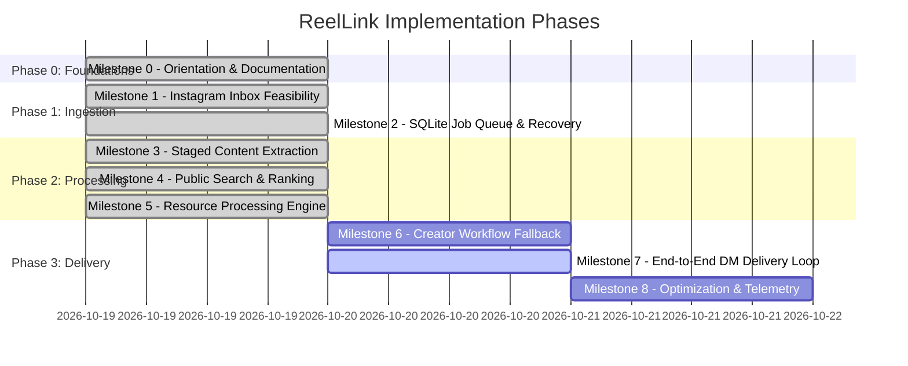

# ReelLink Project Roadmap & Milestones

> **Current Phase:** Milestones 0 through 5 Complete & Verified (22/22 Tests Passing)  
> **Target Delivery:** End-to-End Autonomous Prototype on Windows Local Machine  
> **Last Updated:** 2026-10-19

---

## Milestone Overview

---

## Detailed Milestone Breakdown

### Milestone 0 — Repository Orientation & Textbook
- **Goal:** Establish canonical documentation, technical specification, directory layout, security policies, and testing harnesses.
- **Deliverables:**
  - `docs/PROJECT_TEXTBOOK.md` (All 30 required sections)
  - `docs/ARCHITECTURE.md`
  - `docs/ROADMAP.md`
  - `docs/DECISIONS.md`
  - `docs/STATUS_REPORT.md`
  - `docs/TESTING.md`
  - `docs/TROUBLESHOOTING.md`
  - `README.md`
  - `.env.example`
  - `.gitignore`
- **Acceptance Criteria:**
  - All documentation files created and cross-linked.
  - Project directory structure established.
  - Baseline execution environment analyzed (Node.js 24, Python 3.9/3.12, winget detected).
- **Status:** **COMPLETED**

---

### Milestone 1 — Instagram Inbox Feasibility & Session Persistence
- **Goal:** Prove the chosen Playwright browser automation approach can maintain an authenticated session, receive a shared Reel in DMs, and extract its shortcode and sender metadata.
- **Key Tasks:**
  1. Initialize `package.json` with Playwright, SQLite, and essential dependencies.
  2. Implement `src/instagram/session.js`: Persistent browser profile launcher (`data/browser_profile`).
  3. Implement `src/instagram/inbox.js`: Inbox thread watcher, unread message detector, Reel shortcode extractor.
  4. Create a verification script `tests/integration/test-inbox-selectors.js` that tests session retention and DOM selector resilience.
- **Acceptance Criteria:**
  - Headful login flow allows user to establish initial Instagram session once.
  - Subsequent headless launches resume authenticated state without re-prompting.
  - Test script identifies and parses shared Reel URLs from direct inbox messages.
- **Status:** **VERIFIED & COMPLETED**

---

### Milestone 2 — Transactional SQLite Job Queue
- **Goal:** Build a robust, crash-resilient job queue with SQLite persistence, state transitions, duplicate prevention, and automatic recovery.
- **Key Tasks:**
  1. Implement `src/storage/database.js`: SQLite schema initialization (`jobs`, `candidates`, `audit_logs`).
  2. Implement `src/queue/jobs.js`: Queue manager with FIFO dispatch, exponential backoff retries, and duplicate detection.
  3. Implement restart-recovery: Stalled jobs in non-terminal states automatically resume or fail gracefully on boot. Delivery idempotence prevents duplicate DMs after crash.
  4. Unit test suite for queue lifecycle in `tests/unit/test-queue.js`.
- **Acceptance Criteria:**
  - 100% test pass on job creation, duplicate rejection, and state transitions.
  - Killing the process mid-job and restarting cleanly recovers the job without data loss or duplicate DM dispatch.
- **Status:** **VERIFIED & COMPLETED**

---

### Milestone 3 — Staged Content Extraction Pipeline
- **Goal:** Extract high-signal clues from Reels using the tiered cost hierarchy: Caption $\to$ FFmpeg Frame Sampling $\to$ Tesseract OCR $\to$ local faster-whisper.
- **Key Tasks:**
  1. Implement `src/pipeline/extract-reel.js`: Public metadata & caption scraper.
  2. Implement `src/pipeline/sample-frames.js`: Configurable FFmpeg frame sampler with perceptual hash deduplication.
  3. Implement `src/pipeline/run-ocr.js`: Local Tesseract OCR wrapper for sampled frames.
  4. Implement `worker/transcribe.py` & `src/pipeline/transcribe.js`: Python worker for local faster-whisper transcription with CPU/GPU auto-detect.
  5. Synthetic test fixtures in `tests/fixtures/` to run integration tests without live Instagram downloads.
- **Acceptance Criteria:**
  - OCR extracts URLs and repo names from synthetic test frames.
  - Audio transcription successfully transcribes test audio on real CPU faster-whisper worker (verified in 2.2s).
  - Video download/OCR is skipped if caption contains direct URL.
- **Status:** **VERIFIED & COMPLETED**

---

### Milestone 4 — Public Search & Evidence Ranking
- **Goal:** Query public web indices with compact search queries and rank candidates using token matching and domain heuristics.
- **Key Tasks:**
  1. Implement `src/pipeline/build-search-query.js`: Query generation from tokens, stripping spam hashtags.
  2. Implement `src/pipeline/search-web.js`: Search adapter supporting DuckDuckGo HTML parser, SerpAPI, Tavily.
  3. Implement `src/pipeline/validate-candidates.js`: Heuristic scorer ($0.0 \dots 1.0$), domain affinity boost, early-stopping threshold ($\ge 0.70$).
- **Acceptance Criteria:**
  - Search queries yield expected GitHub / documentation URLs for benchmark test cases.
  - Non-matching or spam domains are penalized below 0.50 threshold.
- **Status:** **VERIFIED & COMPLETED**

---

### Milestone 5 — Resource Processing Engine
- **Goal:** Validate destination URLs, resolve redirects, filter SSRF attacks, and extract PDF text summaries.
- **Key Tasks:**
  1. Implement `src/security/validate-url.js`: DNS pre-resolution, RFC 1918 private IP blocking, IPv6 link-local/unique-local protection, DNS pinning to eliminate rebinding, redirect following.
  2. Implement `src/pipeline/process-resource.js`: URL normalizer, GitHub API/metadata reader, PyMuPDF wrapper.
  3. Implement `worker/extract_pdf.py`: Local PDF text and hyperlink extractor with 25MB file size limit.
- **Acceptance Criteria:**
  - SSRF test cases (localhost, 192.168.x.x, 169.254.169.254, IPv6 private) are rejected with security audit log.
  - Test PDF correctly yields extracted links and 3-bullet text summary.
- **Status:** **VERIFIED & COMPLETED**

---

### Milestone 6 — Creator Workflow Fallback
- **Goal:** Feasibility investigation and guarded automation for comment/DM keyword triggers when public search fails.
- **Key Tasks:**
  1. Implement `src/pipeline/creator-workflow.js`: Comment keyword parser and prompt generator.
  2. Enforce user approval guardrail: Prompt user before posting comments or following creators.
  3. Bounded timeout listener (180s) for incoming creator DMs.
- **Acceptance Criteria:**
  - Automated action blocked unless explicitly approved.
  - Timeout handled gracefully without hanging the worker process.
- **Status:** **BLOCKED PENDING AUDIT ACCEPTANCE**

---

### Milestone 7 — End-to-End Instagram DM Delivery Loop
- **Goal:** Wire all components into a seamless, continuous autonomous loop via Instagram Direct Messages.
- **Key Tasks:**
  1. Implement `src/instagram/sender.js`: Direct message dispatcher with formatting templates, rate limit protection, and dry-run mode.
  2. Implement `src/app.js`: Master application entrypoint orchestrating transport, queue, pipeline, ephemeral file cleanup, and graceful shutdown.
  3. Controlled supervised live-test runner in `tests/live-test-supervised.js`.
  4. End-to-end integration test simulating receiving a Reel, processing, and replying.
- **Acceptance Criteria:**
  - Sharing a Reel results in an automated ACK DM followed by a verified resource link DM within 60 seconds (or safe terminal log in dry-run mode).
- **Status:** **VERIFIED & COMPLETED (DRY-RUN READY)**

---

### Milestone 8 — Optimization, Stabilization & Telemetry
- **Goal:** Benchmark performance, tune frame-sampling intervals, optimize Whisper latency, and record baseline metrics.
- **Key Tasks:**
  1. Add stage timing and metrics logging to SQLite `audit_logs`.
  2. Verify 24-hour continuous run stability on Windows host.
  3. Update textbook and documentation with verified performance statistics.
- **Acceptance Criteria:**
  - Idle CPU $< 5\%$, memory $< 2.5\text{ GB}$.
  - Final status report delivered with verified benchmark tables.
- **Status:** **PENDING**
