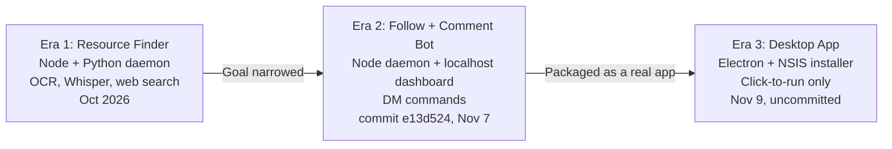

# Chapter 2: Project history

ReelLink went through three distinct designs. Each one removed something the previous one was built around. Understanding why is the best preparation for explaining the project.

> **Sources.** The repo has only one commit, so there is no step-by-step git history. Era 1 is reconstructed from the old docs dated 2026-10-19. Era 2 is the code in commit `e13d524`. Era 3 is the uncommitted working tree.

---

## Era 1: The autonomous resource finder (October 2026)

**The goal was ambitious.** You share a Reel, and the bot finds the promised link by itself and DMs it back, *without* commenting or following at all.

The design was a tiered pipeline, cheapest step first:

1. Parse the caption for a direct link.
2. If none, download the video, sample frames with FFmpeg, and run Tesseract OCR to read on-screen text.
3. If still nothing, extract the audio and transcribe it with a local `faster-whisper` Python worker.
4. Build a search query and try DuckDuckGo, SerpAPI, Tavily or Google.
5. Score candidates 0.0 to 1.0 against the evidence.
6. Validate the URL with SSRF protection and DNS pinning, then process PDFs and GitHub links.
7. DM the verified link back. If everything failed, fall back to following and commenting.

It ran as a Node.js daemon polling the inbox every 15 seconds, with Python subprocesses. Files like `run-ocr.js`, `transcribe.js`, `search-web.js` and `validate-candidates.js` belong to this era.

**Why it did not last.** The creators' resources are often not public. The link is delivered privately *because* it is gated, so searching the web was frequently a guess. The fallback path, simply doing what the creator asked, was the one that reliably worked. (This motive is inferred from how the code evolved: the search stack was disconnected while the comment path was kept and strengthened.)

## Era 2: The follow + comment bot with a web dashboard (to 2026-11-07)

**The goal narrowed to the part that works.** Follow the creator, comment the keyword, stop. The creator's own bot delivers the link to the bot account.

What this era added:

- **Follow-first workflow** with real verification of the button state.
- **Comment-only completion.** The job ends when the comment is verified. The code calls this the "comment-only workflow", and tests named `Comment-Only Workflow` protect it. Waiting for DMs and forwarding them was retired.
- **A batch trigger.** Instead of acting as Reels arrive, you share all day and trigger one run.
- **A web dashboard** at `http://localhost:3000`, served by a hand-written Node `http` server.
- **DM bot commands**: `/start`, `/status`, `/history`, `/reset`, `/unfollow` typed in the Instagram chat.
- **A 48-hour retention rule** for unfollowing.
- **An allowlist** of senders, with several layers of checks.
- **Simulation vs live state separation** in the database.

By this commit the OCR, Whisper and search modules still existed, but `src/app.js` no longer called them. They were dead code waiting to be deleted.

**How you ran it.** From a terminal: `npm run setup:session` once, then `npm run dashboard`, keep the terminal open, and open a browser to `localhost:3000`.

**What was wrong with it.**

| Problem | Detail |
|---|---|
| Not an app | Required Node, a terminal and an open console window |
| Exposed control API | The server sent `Access-Control-Allow-Origin: *`, had no authentication and listened on all network interfaces. Any web page you visited, or any device on your network, could call `POST /api/start` or `POST /api/unfollow` |
| Background polling | The loop kept touching Instagram every 15 s even in batch mode |
| Multiple triggers | Dashboard and DM commands could both start work |
| Ran from the repo | Data sat in `./data` beside the code |
| Bundled Chromium | With a hardcoded fake Chrome user-agent |
| Silent failure | If the inbox scan failed, it returned an empty list, which looked like "no new Reels" |

## Era 3: The Windows desktop app (2026-11-09, uncommitted)

**The goal: a real double-click Windows application** with an installer and no terminal.

The core logic was kept. The shell around it was replaced:

- **Electron** provides the window, in place of a browser tab.
- **IPC** replaces the HTTP API, so there is no network port at all.
- The core became an **EventEmitter** with `startBatch`, `stopBatch`, `unfollow`, `login` and `getStatus`.
- **Polling is gone.** Nothing happens until a button is clicked, and the browser closes after each task.
- **Data moved** to `%APPDATA%\ReelLink`.
- **Installed Microsoft Edge** replaces bundled Chromium, so the installer stays smaller and the browser is a real one.
- **One owner, hardcoded**, replaced the configurable allowlist.
- About **3,800 lines of production code were deleted**: the Era 1 pipeline, the web server, the approval CLI.
- **A proper installer** is built by `electron-builder`.

[Chapter 3](03-what-changed.md) lists every change.

## The lesson

The project got simpler at every step, and better. The final product does less than Era 1 was meant to, but what it does is reliable.

A good way to say this in an interview: *"I started by building the sophisticated solution. Real usage showed that the fallback was the actual product, so I cut the pipeline, deleted thousands of lines, and focused on making the simple path reliable and easy to use."*
