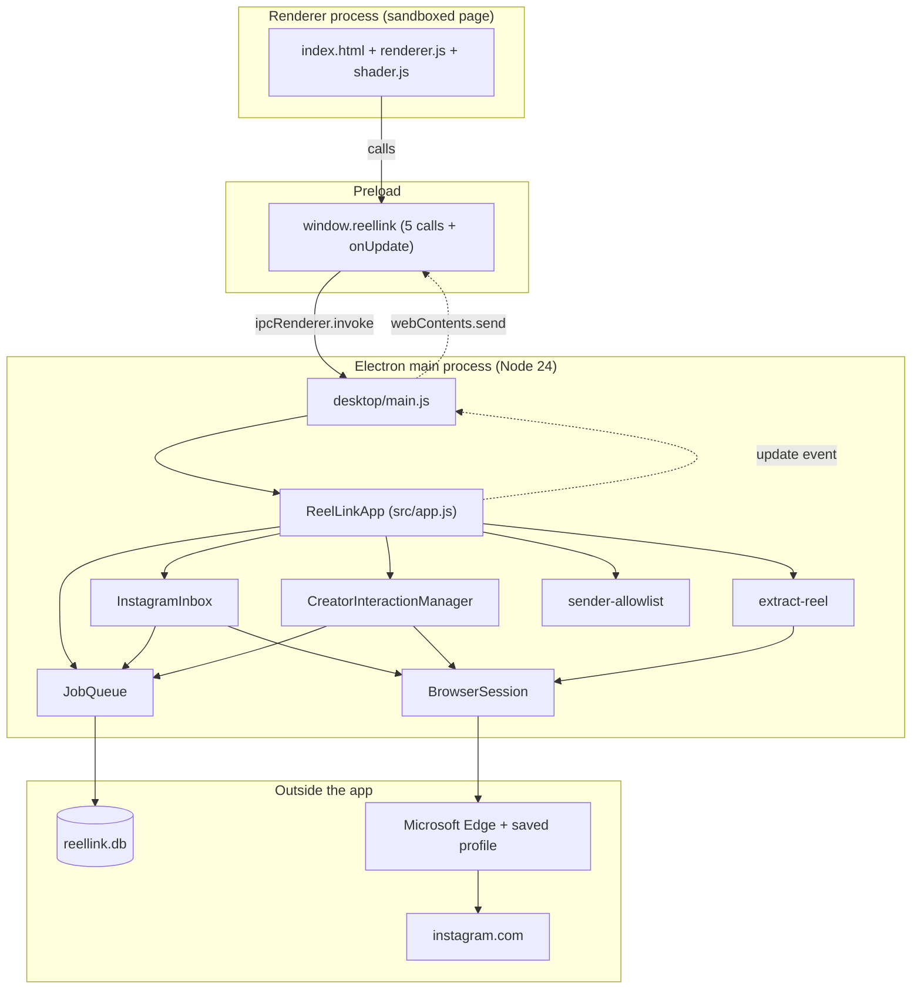
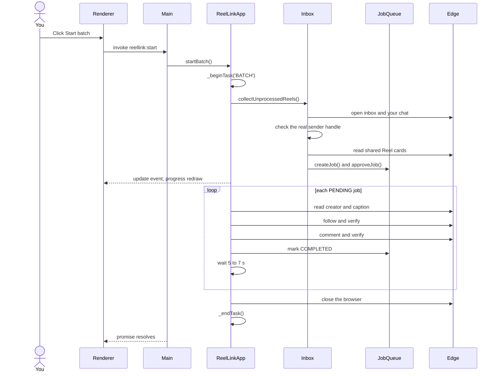

# Chapter 4: System architecture

## 4.1 The one-paragraph version

ReelLink is a single-user **Electron** desktop app. The window (renderer) is a sandboxed web page that can only talk to the **main process** through five fixed IPC calls. The main process hosts the **core** (`ReelLinkApp`), a plain Node.js object. The core drives a real **Microsoft Edge** window using **Playwright** and stores everything in a local **SQLite** database. Work happens only when you click a button, and the browser closes when the task ends.

## 4.2 The big picture



## 4.3 Layers

| Layer | Folder | Responsibility | Knows about |
|---|---|---|---|
| Presentation | `desktop/renderer/` | Draw state, capture clicks | Only `window.reellink` |
| Bridge | `desktop/preload.js` | Expose a fixed API | Electron IPC |
| Shell | `desktop/main.js` | Window lifecycle, route IPC | The core's public methods |
| Application | `src/app.js` | Run batches, enforce one task at a time | All services below |
| Domain | `src/pipeline/` | Keyword rules, follow/comment workflow | Queue, browser |
| Integration | `src/instagram/` | Everything that touches Instagram's pages | Playwright |
| Persistence | `src/queue/`, `src/storage/` | Jobs, deduplication, recovery | SQLite |
| Cross-cutting | `src/config/`, `src/security/`, `src/utils/` | Settings, sender rule, logs, URLs | Nothing above them |

**The most important boundary:** `src/` has no idea Electron exists. The core takes plain options and emits events. That is why the tests run under plain `node --test`, and why the same core could sit behind a different UI.

## 4.4 Processes at runtime

| Process | Started by | Lifetime | Runs |
|---|---|---|---|
| Electron main | You | Until the window closes | `main.js` and all of `src/` |
| Electron renderer | Main | With the window | The page, with no Node access |
| Electron GPU and helpers | Electron | With the app | WebGL and so on |
| Microsoft Edge | Playwright | One task only | Instagram |

There are no worker threads and no other subprocesses. The core runs in the main process.

**Does this block the window?** The core is almost entirely asynchronous waiting on the browser. The synchronous part, SQLite through `DatabaseSync`, is single small queries on a local file. The renderer has its own process, so its drawing continues regardless.

## 4.5 Directory map

```
ReelLink/
├─ desktop/                  Electron layer
│  ├─ main.js                main process entry (package.json "main")
│  ├─ preload.js             safe bridge
│  └─ renderer/              the UI
├─ src/                      the core, with no Electron imports
│  ├─ app.js                 ReelLinkApp orchestrator
│  ├─ config/index.js        settings and the hardcoded owner
│  ├─ instagram/
│  │  ├─ session.js          Playwright browser and login
│  │  ├─ inbox.js            finds Reels in your chat
│  │  └─ sender.js           sends DMs (idle in the desktop flow)
│  ├─ pipeline/
│  │  ├─ extract-reel.js     reads creator and caption
│  │  └─ creator-interaction.js  keyword rules, follow, comment
│  ├─ queue/jobs.js          JobQueue: all job and creator SQL
│  ├─ security/sender-allowlist.js  the owner check
│  ├─ storage/database.js    SQLite setup and schema
│  └─ utils/                 logger, URL helpers
├─ tests/                    unit/ and integration/
├─ docs/                     this book, plus the older docs
├─ data/                     dev-era data (ignored by git)
├─ dist/                     build output (ignored by git)
└─ package.json              scripts and installer config
```

## 4.6 The main flow: a batch



## 4.7 Key patterns

**Dependency injection.** The constructor accepts `db`, `queue`, `browserSession`, `sender`, `inbox` and `creatorManager`. Production uses the real ones; tests pass fakes. This is the reason 103 tests run without Instagram.

**Observer.** The core emits `'update'` with no data. The window responds by requesting a fresh snapshot. The event says "something changed", never what changed, so the UI always draws one consistent state.

**Mutex.** `activeTask` guards the one browser. It works without real locks because JavaScript runs on one thread and the check-and-set happens without an `await` between them.

**State machine.** Each job moves through a set of statuses saved in SQLite, so a restart knows exactly where things stopped ([Chapter 12](12-data-layer.md)).

**Fail closed.** When identity is uncertain, the answer is no.

**Idempotent steps.** Before each follow or comment, the database is checked for whether it already happened, which makes retries safe ([Chapter 10](10-follow-comment-workflow.md)).

**Fallback chains.** Instagram's pages change, so reads try several strategies in order. For example, the creator's name is tried from JSON-LD, then Open Graph description, then title, then links ([Chapter 9](09-caption-and-keywords.md)).

## 4.8 Technology choices at a glance

| Need | Choice | Why (details in [Chapter 19](19-design-decisions.md)) |
|---|---|---|
| Desktop shell | Electron 45 | The existing Node core and web UI could be kept |
| Browser automation | Playwright 1.64 | Persistent profiles and a real-browser channel option |
| Browser | Installed Edge | Ships with Windows, no Chromium to bundle |
| Database | `node:sqlite` | Built into Electron's Node, no native module to rebuild |
| Installer | electron-builder, NSIS | Standard Windows setup wizard |
| Tests | `node:test` | Built in, no framework |
| Graphics | Raw WebGL | No dependencies |

Runtime versions were confirmed directly: Electron 45.2.3 embeds **Node 24.22.2** and **Chromium 156**.

## 4.9 Where data lives

Everything is in `%APPDATA%\ReelLink\`:

| Item | Purpose |
|---|---|
| `reellink.db` (`-wal`, `-shm`) | Jobs, creators, audit log |
| `browser_profile\` | The saved Instagram login. **Treat this like a password** |
| `reellink.log` | Log file |
| Other folders (`Cache`, `GPUCache`, `Local Storage`...) | Electron's own files for the window |

Running from source uses the same folder, because `app.getPath('userData')` resolves to the same name on case-insensitive Windows. So `npm start` and the installed app share one database and login.

## 4.10 What is deliberately absent

No server. No background service or tray icon. No auto-update code. No telemetry. No cloud. No Instagram API.
