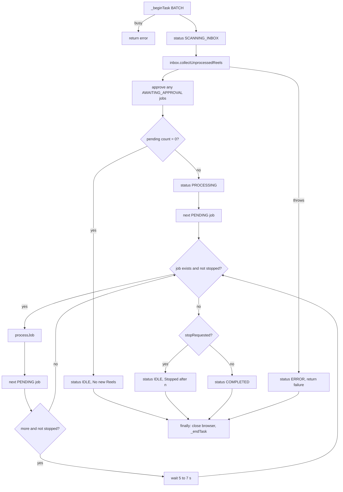

# Chapter 7: The core orchestrator

File: [`src/app.js`](../../src/app.js), 382 lines, class `ReelLinkApp extends EventEmitter`

This class decides *what happens when*. The other modules decide *how*.

## 7.1 Construction

```js
new ReelLinkApp({ live: true })
```

Each collaborator can be injected, which is how tests replace them:

```js
this.db = options.db || getDatabase();
this.queue = options.queue || new JobQueue(this.db);
this.browserSession = options.browserSession || new BrowserSession();
this.sender = options.sender || new InstagramSender(this.browserSession);
this.inbox = options.inbox || new InstagramInbox(this.browserSession, {...});
this.creatorManager = options.creatorManager || new CreatorInteractionManager({...});
this.inbox.creatorManager = this.creatorManager;
```

`this.isLiveMode = options.live !== false`. Live is the default, and only an explicit `false` gives simulation.

### State fields

| Field | Values | Meaning |
|---|---|---|
| `activeTask` | `'BATCH'`, `'UNFOLLOW'`, `'LOGIN'`, `null` | What holds the browser |
| `isBatchRunning` | boolean | A batch is in progress |
| `stopRequested` | boolean | Stop after the current Reel |
| `batchStatus` | `IDLE`, `SCANNING_INBOX`, `PROCESSING`, `COMPLETED`, `ERROR` | Shown in the UI |
| `batchProgress` | `{current, total, currentJob, summary}` | Progress bar data |
| `currentJob`, `currentJobId` | job or null | The Reel in flight |
| `recentLogs` | up to 200 `{time, message}` | The activity log |

## 7.2 `init()`

Run once at startup. It calls `queue.recoverStalledJobs()` and logs the mode and owner. It is separate from the constructor so that tests can create an app without side effects.

## 7.3 The task lock

```js
_beginTask(name) {
  if (this.activeTask) {
    return { ok: false, error: `Busy: ${this.activeTask.toLowerCase()} is already running` };
  }
  this.activeTask = name;
  this._emitUpdate();
  return { ok: true };
}
```

Every browser operation begins with this and ends with `_endTask()` inside a `finally`.

**Why is this race-free?** JavaScript runs one thing at a time and there is no `await` between the check and the assignment. Nothing can run in between.

## 7.4 `startBatch()` step by step



Points worth knowing:

1. **It processes all `PENDING` jobs**, not only those found in this scan. Jobs left over from a crash or a Stop get picked up.
2. **The loop asks the database for the next job each time** rather than iterating a list, so it always sees the true state.
3. **The pause** is `Math.floor(Math.random() * 3) + 5`, giving 5, 6 or 7 seconds. It paces actions and avoids a machine-regular rhythm.
4. **Errors are returned, not thrown,** so the UI can show them.
5. **`finally` always closes the browser**, whatever happened.

## 7.5 `stopBatch()`

Sets `stopRequested`, and returns `false` if no batch is running. The loop checks the flag between Reels. It never interrupts mid-Reel, because stopping between a follow and a comment would leave a half-finished action.

## 7.6 `processJob(job)` step by step

1. **Security gate:** `assertSenderAllowed(job.sender_username, ...)`. If rejected, the job becomes `FAILED` with `IGNORED_UNAUTHORIZED_SENDER`.
2. Status → `EXTRACTING`.
3. `fetchReelPublicData()` reads creator and caption.
4. **No creator? Stop.** Mark `FAILED`: "never guess who to follow".
5. Extract the keyword, or use 🙌 ([Chapter 9](09-caption-and-keywords.md)).
6. Create the `creator_interactions` row.
7. Status → `INTERACTING`.
8. `creatorManager.executeCreatorWorkflow()` follows and comments ([Chapter 10](10-follow-comment-workflow.md)).
9. On success: `COMPLETED`, log ✔. Otherwise: `FAILED`, log ✖.
10. On an exception: `queue.handleJobError()`, which may schedule a retry.

**Two kinds of failure.** A *returned* failure (for example "Follow button not found") is final: the job becomes `FAILED`. A *thrown* exception goes to the retry logic. Most page-level errors are caught and returned, so in practice retries are rare. See [Chapter 12](12-data-layer.md).

## 7.7 `unfollow({ forceAll })`

Takes the task lock, fetches eligible creators ([Chapter 11](11-unfollow-manager.md)), unfollows each with a 1.2 s pause, and returns a summary. It closes the browser in `finally`.

## 7.8 `login()`

Takes the lock and calls `browserSession.interactiveLogin()`. The core never sees your password, because you type it directly into Edge.

## 7.9 `getStatus()`

Gathers the UI snapshot from memory and the database. It is synchronous and fast.

## 7.10 `shutdown()`

Sets `stopRequested`, closes the browser, closes the database. It deliberately does not exit the process; Electron does that. Errors are caught so a problem closing the browser can't prevent exit.

## 7.11 Logs: two different things

| | `_addLog()` | `logger.*` |
|---|---|---|
| Audience | You, in the window | A developer, in the log file |
| Style | Short, friendly | Detailed, structured |
| Storage | In memory, last 200 | `reellink.log` and console |

A third record, the `audit_logs` table, tracks job state changes.
