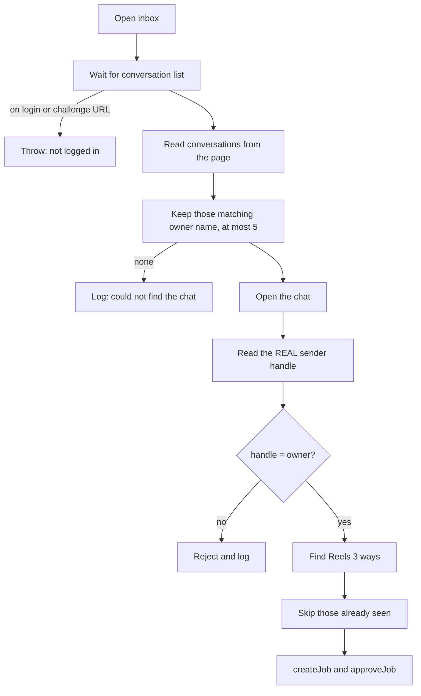

# Chapter 8: Instagram automation

Files: [`session.js`](../../src/instagram/session.js), [`inbox.js`](../../src/instagram/inbox.js), [`sender.js`](../../src/instagram/sender.js), [`url-helper.js`](../../src/utils/url-helper.js)

## 8.1 Why a real browser?

Three ways to automate Instagram were considered in the original design:

| Option | Verdict |
|---|---|
| Official Graph API | Needs a business account and Meta app review, and doesn't suit a personal tool |
| Unofficial mobile API libraries | Fragile and likely to get accounts flagged |
| **Real browser automation** | Chosen. You log in normally, once, and the app behaves like a user |

The trade-off: page structure changes can break the automation. That is why the code tries several selectors everywhere.

## 8.2 `BrowserSession`

### Launching

```js
this.context = await chromium.launchPersistentContext(this.profileDir, {
  headless: this.headless,
  ...(this.channel ? { channel: this.channel } : {}),   // 'msedge'
  viewport: { width: 1280, height: 800 },
  args: ['--disable-blink-features=AutomationControlled', '--no-sandbox', '--disable-dev-shm-usage'],
  locale: 'en-US',
});
```

| Option | Why |
|---|---|
| `launchPersistentContext` | Cookies and storage live on disk in a profile folder, so the login survives |
| `channel: 'msedge'` | Uses the Edge already on Windows; nothing to bundle |
| `locale: 'en-US'` | The code matches English button text like "Follow" |
| `--disable-blink-features=AutomationControlled` | Removes an obvious automation flag |
| `--no-sandbox` | Disables the browser sandbox. A trade-off noted in [Chapter 18](18-known-issues-and-dead-code.md) |

`getContext()` launches at most once. If a launch is already happening, later callers wait for it. A `close` listener clears the saved references if the browser disappears.

`getPage()` returns the first open tab, or opens one.

### Login

`interactiveLogin()`:

1. Forces a visible window (`headless = false`).
2. Opens `/accounts/login/`.
3. Every 2 seconds, checks whether you've reached a page with navigation elements and are no longer on a login, sign-up, one-tap or challenge URL.
4. Returns `{authenticated: true}`, or a reason if you closed the window or 10 minutes passed.
5. Always closes the browser in `finally`.

2FA and challenges just work, because you handle them yourself in the real window. The app never touches your password.

## 8.3 The inbox scan

`collectUnprocessedReels()` runs in stages:



### Step 1: Finding the chat

Instagram's inbox list shows **display names**, not handles. So `looksLikeOwnerThread()` compares against both `ksydn_` and the display name `Naumannn`.

**This is not a security check.** Anyone could set their display name to "Naumannn". It only chooses which chat to open.

Two extraction methods combine: links containing `/direct/t/`, and the newer `div[role="button"]` rows (recognised by text like "sent an attachment" or "·"). Rows without a link get a temporary ID like `row_0` and are clicked to learn the real ID.

### Step 2: Verifying the sender

Inside the chat, four strategies look for the real handle:

1. A link with an `aria-label` containing "profile page of X".
2. An `aria-label` like "React to message from X", skipping the bot's own (`dolphin.*`).
3. A header link such as `/handle/`.
4. Header text that looks like a handle.

Then `assertSenderAllowed()` decides. If only the display-name hint is available, the check fails, since `naumannn` isn't the allowed handle. That is the correct direction to fail.

### Step 3: Detecting Reels three ways

| # | Source | How | `source` value |
|---|---|---|---|
| 1 | Pasted URL | Regex over text bubbles | `text` |
| 2 | Link in the page | `a[href*="/reel/"]`, `/reels/`, `/p/` | `link` |
| 3 | **Shared Reel card** (the usual case) | `div[role="button"]` containing a "Clip" icon | `shared_clip_card` |

Messages that start with `/` or `!`, or equal `start`, are treated as commands and skipped. They can never become jobs.

### Step 4: Unique message IDs

Instagram's web page doesn't expose a stable message ID, so ReelLink builds one:

| Source | Format |
|---|---|
| Pasted text | `msg_<thread>_<sender>_text_<shortcode>` |
| Link | `msg_<thread>_<sender>_link_<shortcode>` |
| Shared card | `msg_<thread>_<sender>_clip_<mediaId>_<occurrence>` |
| Old-format card | `msg_<thread>_<sender>_clip_<mediaId>` (still honoured) |

For a card, `mediaId` comes from the preview image URL's `ig_cache_key`, or a long number in the URL. Small avatars are filtered out (`profile_pic`, `s50x50`, `s150x150`, or 60px or less), because the creator's avatar would be the same across all their Reels.

`occurrence` counts how many times that media appears. If you share the same Reel twice, the second is a genuinely new request.

### Step 5: Resolving a card

A card doesn't reveal its shortcode. So, **only for messages not already seen**:

1. Click the card.
2. Wait up to 4 s for the URL to contain `/reel/`, `/reels/` or `/p/`.
3. Extract the shortcode (or find a link in the dialog).
4. Press Escape and click Close to return.

Checking the database *before* clicking avoids needless actions on old messages.

### Step 6: Enqueueing

`createJob({ enforceAllowlist: true })` re-checks the sender and writes the row; `approveJob()` marks it approved.

**Limits** (details in Chapter 18): only messages currently loaded in the page are seen, and the first-ever batch treats everything visible as new.

## 8.4 URL helpers

The regular expression:

```js
/(?:https?:\/\/)?(?:www\.)?instagram\.com\/(?:reel|reels|p|tv)\/([A-Za-z0-9_-]+)/i
```

| Function | Example |
|---|---|
| `extractReelShortcode` | `.../reels/AbC_12-x/?igsh=zzz` → `AbC_12-x` |
| `normalizeReelUrl` | `AbC_12-x` → `https://www.instagram.com/reel/AbC_12-x/` |
| `cleanTrackingParams` | Strips `utm_*`, `ig_*`, `igsh`, `igshid`, `fbclid`, `gclid`, `ref` |

## 8.5 Network listening

`_attachNetworkListener()` watches GraphQL responses for button links that aren't drawn in the page. It only supported the retired reply-reading feature, but still runs when a page opens.

## 8.6 `InstagramSender`

Types and sends DMs with Shift+Enter for line breaks. **The desktop flow sends no DMs.** It remains because `InstagramInbox` is constructed with it, and tests cover it.

## 8.7 Resilience techniques to mention

| Technique | Example |
|---|---|
| Selector fallback lists | Five selectors for the message box |
| Semantic selectors over CSS classes | `aria-label`, `role`, `href` patterns, since class names change |
| Exact text matching | Must equal "Follow", so "Following" can't match |
| Waiting on real conditions | `waitForFunction`, `waitForURL` |
| Dismissing popups | "Not Now", cookie banners |
| Detecting dead pages | `_ensurePage()` |
