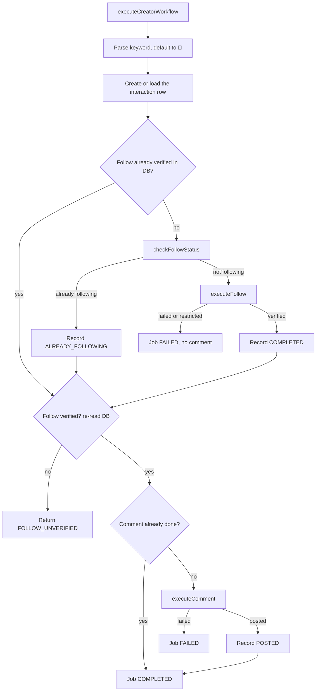

# Chapter 10: The follow-and-comment workflow

File: [`src/pipeline/creator-interaction.js`](../../src/pipeline/creator-interaction.js), class `CreatorInteractionManager`

This is the part that acts on Instagram, so it has the most safeguards.

## 10.1 The rules

1. **Follow first, always.** Every Reel gets a follow, even if the caption only asks for a comment.
2. **Never comment on an unverified follow.**
3. **Never repeat a completed step,** even across retries and restarts.
4. **Simulation can never count as real.**
5. **Stop on a restriction.**

## 10.2 The flow



## 10.3 Finding buttons

```js
const text = ((await el.innerText()) || '').trim();
if (text === 'Follow' || text === 'Follow Back') { ... }
```

Exact equality matters. A substring search for "Follow" would match "Following". `_findFollowingButton` does the same for "Following" and "Requested". (`Requested` is what a private account shows.)

## 10.4 `executeFollow`

1. Approval check (always passed in the desktop flow).
2. Simulation? Return success without touching the browser.
3. Open the profile if not there. Dismiss popups.
4. Check for restrictions.
5. Already following? Done.
6. Find and click Follow.
7. **Verify:** for up to 5 seconds, every 500 ms, check for a restriction or a Following/Requested button.
8. If it never changes, return `FAILED`.

## 10.5 `executeComment`

1. Approval and simulation checks.
2. Open `/p/<shortcode>/`. Dismiss popups. Check restrictions.
3. Find the comment box. If missing, click the comment icon and look again.
4. Click, select all, delete, and type the keyword with a 60 ms key delay.
5. Check the text arrived. If not, set it through DOM events (React needs an `input` event to notice).
6. Click the exact **Post** button in the form, or press Enter.
7. Wait 3 s, check restrictions again.
8. Verify. If the box still has text, press Enter once more.
9. Succeeds if the box is empty **or** the comment appears in the list.

**Limitation:** an emptied box counts as success even if Instagram silently discarded the comment. The check is good, but not proof.

## 10.6 Restriction detection

`_checkForRestrictions` looks for these phrases in page text:

- `action blocked`
- `try again later`
- `we restrict certain activity`
- `we limit how often`
- `help us confirm you own this account`
- `suspicious activity`
- `checkpoint_required`

On a match, the step returns `RESTRICTED` and the job fails. **The batch itself carries on to the next Reel** (verified). See issue A3 in [Chapter 18](18-known-issues-and-dead-code.md).

## 10.7 Idempotency

Before each step the database is consulted:

```js
const followAlreadyDone = isSim
  ? (isSimulatedFollowCompleted(interaction) || this.queue.isLiveFollowVerified(interaction))
  : this.queue.isLiveFollowVerified(interaction);
```

So if a job restarts after a crash, a follow already recorded isn't repeated, and a comment already recorded isn't repeated.

**The honest limit.** Actions are at-least-once, not exactly-once. If the app dies after Instagram accepts a comment but before the database write, a retry comments again. Instagram offers no transaction spanning both systems.

## 10.8 Simulation and live are stored separately

| Live columns | Simulated columns |
|---|---|
| `follow_status`, `live_follow_verified_at` | `simulated_follow_status`, `simulated_follow_at` |
| `comment_status`, `live_comment_posted_at` | `simulated_comment_status`, `simulated_comment_at` |

`isLiveFollowVerified` returns false if `is_simulated === 1`, regardless of anything else. This was added because earlier simulated runs caused real runs to skip work. In a simulated run, the browser `page` is never touched during follow and comment, which a test asserts.

## 10.9 Approval gates

`executeFollow`, `executeComment` and the workflow all have `approved` checks. In the desktop app, `processJob` passes `approved: true`, because clicking Start is the approval. The gates stay in place and are still tested.

## 10.10 Dead code in this file

About half of this file belongs to retired features: `monitorInboxForResponse`, `forwardLatestCreatorMessage`, `matchCreatorReplyToJob`, `_retiredReplyMonitoring`. [Chapter 18](18-known-issues-and-dead-code.md) has the list.
