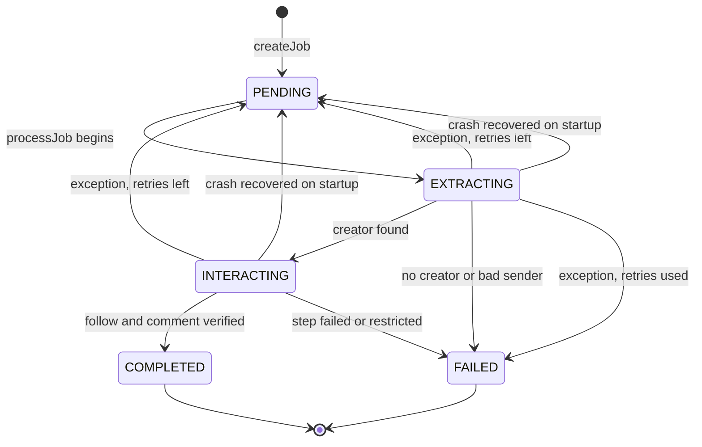

# Chapter 12: The data layer

Files: [`src/storage/database.js`](../../src/storage/database.js), [`src/queue/jobs.js`](../../src/queue/jobs.js)

## 12.1 Why SQLite?

One user, one machine, one process. A database server would be pure overhead. SQLite gives transactions, indexes and SQL in one file, with no daemon.

ReelLink uses `node:sqlite`, which is built into Node. The earlier docs mention `better-sqlite3`, but the code doesn't use it. The benefit became significant with Electron: native modules must be recompiled for Electron's ABI, and a built-in module avoids that entirely. Confirmed present in the Electron runtime (`typeof DatabaseSync === 'function'`).

## 12.2 Setup

```sql
PRAGMA journal_mode = WAL;     -- readers don't block the writer; safer on crashes
PRAGMA foreign_keys = ON;      -- enforce job references
PRAGMA busy_timeout = 5000;    -- wait up to 5 s on a lock
```

Tables are created with `CREATE TABLE IF NOT EXISTS`. **Migrations** are simple: try `ALTER TABLE ... ADD COLUMN` for each newer column and ignore the error if it already exists. Old databases upgrade themselves on open.

`getDatabase()` returns a shared singleton. Tests create separate `new Database(path)` instances.

## 12.3 Tables

### `jobs`: one row per Reel request

| Column | Used now? | Meaning |
|---|---|---|
| `id` | ✅ | UUID |
| `thread_id` | ✅ | The Instagram chat |
| `sender_username` | ✅ | Must be the owner |
| `reel_url`, `shortcode` | ✅ | The Reel |
| `message_id` | ✅ | The deduplication key |
| `status` | ✅ | See 12.4 |
| `stage` | ✅ | `A`, `EXTRACTION`, `INTERACTION` (informational) |
| `retry_count`, `max_retries` | ✅ | Retry tracking |
| `result_summary`, `error_message` | ✅ | Outcome text |
| `is_approved`, `approved_at` | ✅ | Set on enqueue |
| `created_at`, `updated_at`, `completed_at` | ✅ | Timestamps (UTC) |
| `is_delivered`, `delivered_at` | legacy | For sending results by DM |
| `evidence_json`, `candidate_url` | legacy | Era 1 pipeline |

### `creator_interactions`: the follow and comment record

| Columns | Meaning |
|---|---|
| `id`, `job_id` (FK, cascade), `creator_username`, `shortcode` | Identity |
| `requires_follow`, `requires_comment`, `keyword`, `comment_text` | The plan and what was posted |
| `follow_status`, `follow_verified_at`, `live_follow_verified_at` | Real follow |
| `comment_status`, `comment_posted_at`, `live_comment_posted_at` | Real comment |
| `simulated_follow_status/_at`, `simulated_comment_status/_at` | Simulated results |
| `is_simulated` | 1 means this row must not count as real |
| `reply_status`, `reply_received_at`, `extracted_url`, `review_reason`, `last_seen_message_*`, `waiting_since`, `initial_window_expires_at`, `last_inbox_check_at`, `live_comment_verified_at` | Legacy reply tracking |

### `processed_messages`: what has been seen

`message_id` (primary key), `thread_id`, `sender_username`, `shortcode`, `reel_url`, `ack_sent`, `is_baseline`, `created_at`.

### `audit_logs`: history

`job_id`, `level`, `component`, `message`, `metadata_json`, `created_at`. A row is added on every status change.

### `candidates`: unused

Left from the search pipeline. Nothing writes to it in the desktop flow.

## 12.4 The job state machine



`JOB_STATUS` also defines `SEARCHING`, `PROCESSING`, `AWAITING_APPROVAL`, `WAITING_FOR_REPLY` and `NEEDS_REVIEW`. The desktop flow doesn't normally produce them. `AWAITING_APPROVAL` jobs from older versions are approved automatically when a batch starts.

## 12.5 Deduplication

Checked in `createJob`, most specific first:

1. If there's a `messageId`: same `message_id` → duplicate.
2. Else, if thread and shortcode: same pair → duplicate.
3. Else, if shortcode: same shortcode → duplicate.

Using the **message** as the key, not the Reel, is deliberate: sharing the same Reel again later is a new request.

## 12.6 Retries

`handleJobError` runs only on a **thrown** exception:

- If `retry_count + 1 <= max_retries`: back to `PENDING`.
- Otherwise: `FAILED`.

With the default `JOB_MAX_RETRIES=3`, that means up to 4 attempts.

Things to know (all verified):

- Retries happen **immediately in the same batch**. There is no delay beyond the normal 5 to 7 s, even though a comment mentions "backoff".
- A retried job counts toward the progress, so you can see "2 of 1".
- A **returned** failure is final. Most page errors are of this type.
- Because a `FAILED` job's message is already recorded as seen, the next scan skips it. To try again, **share the Reel again** in a new message.

## 12.7 Crash recovery

`recoverStalledJobs()` runs at startup, for jobs in `EXTRACTING`, `SEARCHING`, `PROCESSING` or `INTERACTING`:

1. Sender not allowed → `FAILED`. A restart can't bypass the check.
2. Already delivered → `COMPLETED` (legacy case).
3. `retry_count < max_retries` → `PENDING`.
4. Otherwise → `FAILED`.

Recovery doesn't increase `retry_count`.

## 12.8 Timestamps

SQLite's `datetime('now')` gives UTC without a zone marker. Live and simulated action timestamps are ISO strings with `Z`, written from JavaScript. Age calculations use the ISO ones when available.

## 12.9 Useful queries

Run with the app closed:

```powershell
node -e "const {DatabaseSync}=require('node:sqlite');const db=new DatabaseSync(process.env.APPDATA+'/ReelLink/reellink.db',{readOnly:true});console.table(db.prepare('select status,count(*) n from jobs group by status').all())"
```

Other useful SQL:

```sql
-- Recent failures
SELECT shortcode, error_message, updated_at FROM jobs
WHERE status = 'FAILED' ORDER BY updated_at DESC LIMIT 10;

-- What was posted
SELECT creator_username, keyword, follow_status, comment_status, live_comment_posted_at
FROM creator_interactions ORDER BY created_at DESC LIMIT 20;

-- One job's history
SELECT created_at, level, message FROM audit_logs WHERE job_id = ? ORDER BY id;
```
